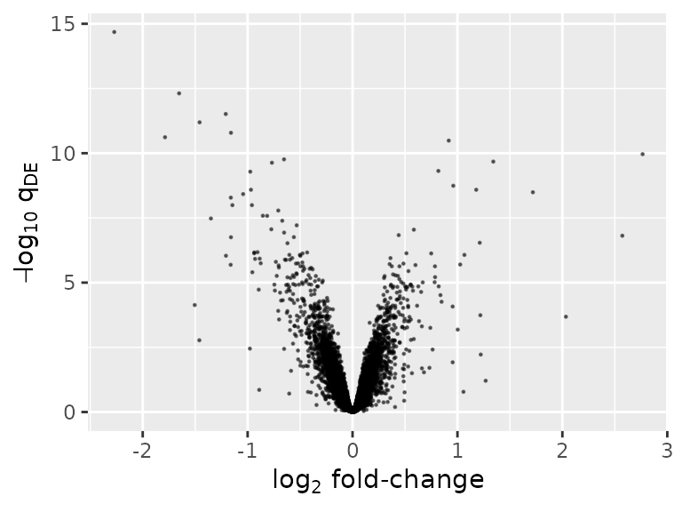
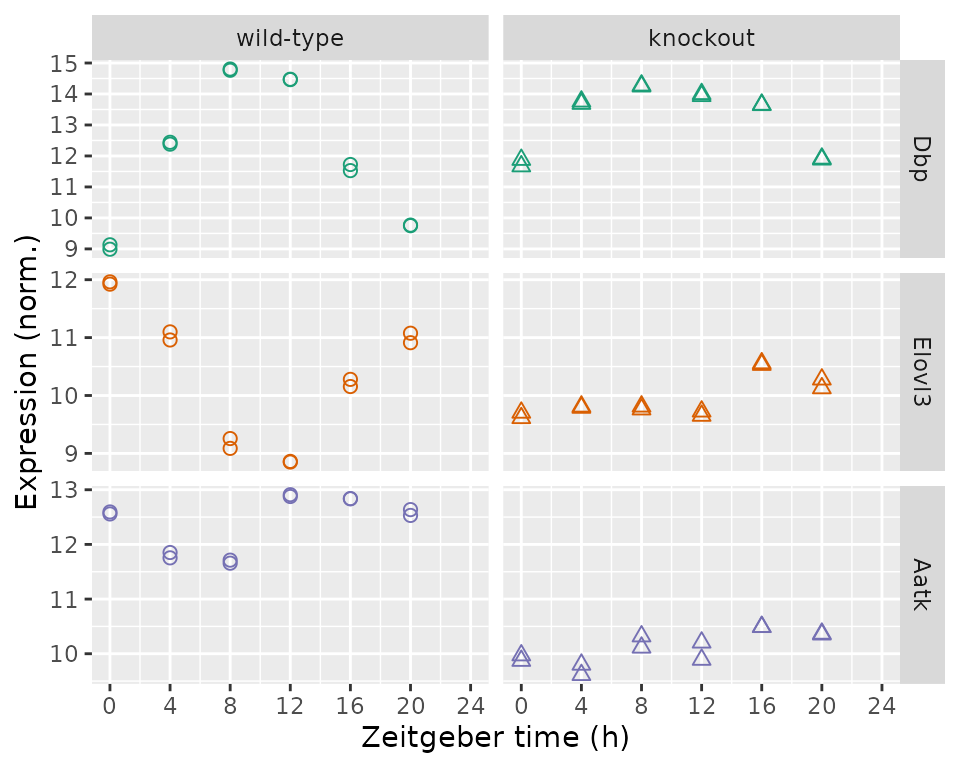

# Analyzing circadian transcriptome data with LimoRhyde

LimoRhyde is a framework for differential analysis of rhythmic
transcriptome data. This vignette goes through the typical steps of an
analysis: identifying rhythmic genes, identifying differentially
rhythmic genes, and identifying differentially expressed genes.

The dataset is based on total RNA from livers of wild-type and
Rev-erb$\alpha/\beta$ knockout mice, with gene expression measured by
microarray
([GSE34018](https://www.ncbi.nlm.nih.gov/geo/query/acc.cgi?acc=GSE34018)).

## Load packages and set parameters

``` r
library('annotate')
library('data.table')
library('foreach')
library('ggplot2')
library('limma')
library('limorhyde')
library('org.Mm.eg.db')
```

Here we specify the zeitgeber period and the q-value cutoffs for
rhythmic and differentially rhythmic genes.

``` r
period = 24
qvalRhyCutoff = 0.15
qvalDrCutoff = 0.1
```

## Load the data

The expression data are in a matrix with one row per gene and one column
per sample. The metadata are in a table with one row per sample.

``` r
y = readRDS(system.file('extdata', 'GSE34018_expression_data.rds', package = 'limorhyde'))
y[1:5, 1:5]
#>       GSM840516 GSM840517 GSM840518 GSM840519 GSM840520
#> 11287  7.985859  7.930935  7.674688  7.899531  7.768563
#> 11298  7.719384  7.737210  7.888502  7.865563  7.772749
#> 11302 12.594006 12.557148 11.754031 11.851858 11.656702
#> 11303  7.868566  7.823121  7.907136  7.906957  7.934719
#> 11304  7.772076  7.930239  7.774563  7.768792  7.740474

metadata = readRDS(system.file('extdata', 'GSE34018_metadata.rds', package = 'limorhyde'))
metadata
#>     sample_id                                  title              genotype
#>        <char>                                 <char>                <char>
#>  1: GSM840516              wild-type liver_ZT0_rep 1             wild-type
#>  2: GSM840517              wild-type liver_ZT0_rep 2             wild-type
#>  3: GSM840518              wild-type liver_ZT4_rep 1             wild-type
#>  4: GSM840519              wild-type liver_ZT4_rep 2             wild-type
#>  5: GSM840520              wild-type liver_ZT8_rep 1             wild-type
#>  6: GSM840521              wild-type liver_ZT8_rep 2             wild-type
#>  7: GSM840522             wild-type liver_ZT12_rep 1             wild-type
#>  8: GSM840523             wild-type liver_ZT12_rep 2             wild-type
#>  9: GSM840524             wild-type liver_ZT16_rep 1             wild-type
#> 10: GSM840525             wild-type liver_ZT16_rep 2             wild-type
#> 11: GSM840526             wild-type liver_ZT20_rep 1             wild-type
#> 12: GSM840527             wild-type liver_ZT20_rep 2             wild-type
#> 13: GSM840504  Reverb alpha/beta DKO liver_ZT0_rep 1 Reverb alpha/beta DKO
#> 14: GSM840505  Reverb alpha/beta DKO liver_ZT0_rep 2 Reverb alpha/beta DKO
#> 15: GSM840506  Reverb alpha/beta DKO liver_ZT4_rep 1 Reverb alpha/beta DKO
#> 16: GSM840507  Reverb alpha/beta DKO liver_ZT4_rep 2 Reverb alpha/beta DKO
#> 17: GSM840508  Reverb alpha/beta DKO liver_ZT8_rep 1 Reverb alpha/beta DKO
#> 18: GSM840509  Reverb alpha/beta DKO liver_ZT8_rep 2 Reverb alpha/beta DKO
#> 19: GSM840510 Reverb alpha/beta DKO liver_ZT12_rep 1 Reverb alpha/beta DKO
#> 20: GSM840511 Reverb alpha/beta DKO liver_ZT12_rep 2 Reverb alpha/beta DKO
#> 21: GSM840512 Reverb alpha/beta DKO liver_ZT16_rep 1 Reverb alpha/beta DKO
#> 22: GSM840513 Reverb alpha/beta DKO liver_ZT16_rep 2 Reverb alpha/beta DKO
#> 23: GSM840514 Reverb alpha/beta DKO liver_ZT20_rep 1 Reverb alpha/beta DKO
#> 24: GSM840515 Reverb alpha/beta DKO liver_ZT20_rep 2 Reverb alpha/beta DKO
#>     sample_id                                  title              genotype
#>        <char>                                 <char>                <char>
#>      time      cond
#>     <num>    <fctr>
#>  1:     0 wild-type
#>  2:     0 wild-type
#>  3:     4 wild-type
#>  4:     4 wild-type
#>  5:     8 wild-type
#>  6:     8 wild-type
#>  7:    12 wild-type
#>  8:    12 wild-type
#>  9:    16 wild-type
#> 10:    16 wild-type
#> 11:    20 wild-type
#> 12:    20 wild-type
#> 13:     0  knockout
#> 14:     0  knockout
#> 15:     4  knockout
#> 16:     4  knockout
#> 17:     8  knockout
#> 18:     8  knockout
#> 19:    12  knockout
#> 20:    12  knockout
#> 21:    16  knockout
#> 22:    16  knockout
#> 23:    20  knockout
#> 24:    20  knockout
#>      time      cond
#>     <num>    <fctr>
```

We use `limorhyde` to calculate `time_cos` and `time_sin`, which are
based on the first harmonic of a Fourier decomposition of the `time`
column, and append them to the `metadata` data.table.

``` r
metadata = cbind(metadata, limorhyde(metadata$time, 'time_'))
```

## Identify rhythmic genes

The next three steps use
[limma](https://doi.org/doi:10.18129/B9.bioc.limma). We calculate the
q-value of rhythmicity for each gene using that gene’s p-value for each
condition and adjusting for multiple testing.

``` r
rhyLimma = foreach(condNow = unique(metadata$cond), .combine = rbind) %do% {
  design = model.matrix(~ time_cos + time_sin, data = metadata[cond == condNow])
  fit = lmFit(y[, metadata$cond == condNow], design)
  fit = eBayes(fit, trend = TRUE)
  rhyNow = data.table(topTable(fit, coef = 2:3, number = Inf), keep.rownames = TRUE)
  setnames(rhyNow, 'rn', 'gene_id')
  rhyNow[, cond := condNow]}

rhyLimmaSummary = rhyLimma[, .(P.Value = min(P.Value)), by = gene_id]
rhyLimmaSummary[, adj.P.Val := p.adjust(P.Value, method = 'BH')]
setorderv(rhyLimmaSummary, 'adj.P.Val')

rhyLimmaSummary[1:5, ]
#>    gene_id      P.Value    adj.P.Val
#>     <char>        <num>        <num>
#> 1:   13170 7.783218e-15 1.334277e-10
#> 2:  353187 2.580065e-12 2.211503e-08
#> 3:   15496 4.322474e-12 2.470005e-08
#> 4:   12700 1.536660e-11 6.585740e-08
#> 5:  321018 2.628480e-11 9.012007e-08
```

## Identify differentially rhythmic genes

Differential rhythmicity is based on statistical interactions between
`cond` and the `time` components. We pass all genes to limma (whose
Empirical Bayes does best with many genes), but keep results only for
rhythmic genes, and adjust for multiple testing accordingly.

``` r
design = model.matrix(~ cond * (time_cos + time_sin), data = metadata)

fit = lmFit(y, design)
fit = eBayes(fit, trend = TRUE)
drLimma = data.table(topTable(fit, coef = 5:6, number = Inf), keep.rownames = TRUE)
setnames(drLimma, 'rn', 'gene_id')

drLimma = drLimma[gene_id %in% rhyLimmaSummary[adj.P.Val <= qvalRhyCutoff]$gene_id]
drLimma[, adj.P.Val := p.adjust(P.Value, method = 'BH')]
setorderv(drLimma, 'adj.P.Val')

drLimma[1:5, ]
#>    gene_id condknockout.time_cos condknockout.time_sin   AveExpr        F
#>     <char>                 <num>                 <num>     <num>    <num>
#> 1:   12686            -1.5326997           -0.04338787 10.157657 63.69962
#> 2:  353187             0.6825313           -0.35398532  9.422013 63.33021
#> 3:  270166            -1.0453062            0.26766077 12.112605 57.37334
#> 4:  207818            -0.6412353           -0.15187573 10.482197 57.04975
#> 5:   15486            -0.7315828            0.12824401 12.503645 44.83717
#>         P.Value    adj.P.Val
#>           <num>        <num>
#> 1: 9.697947e-11 2.416131e-07
#> 2: 1.032534e-10 2.416131e-07
#> 3: 2.965555e-10 3.683675e-07
#> 4: 3.148440e-10 3.683675e-07
#> 5: 3.788290e-09 3.545840e-06
```

## Identify differentially expressed genes

Differential expression is based on the coefficient for `cond` in a
linear model with no interaction terms. We pass all genes to limma, but
keep results only for non-differentially rhythmic genes, and adjust for
multiple testing accordingly.

``` r
design = model.matrix(~ cond + time_cos + time_sin, data = metadata)

fit = lmFit(y, design)
fit = eBayes(fit, trend = TRUE)
deLimma = data.table(topTable(fit, coef = 2, number = Inf), keep.rownames = TRUE)
setnames(deLimma, 'rn', 'gene_id')

deLimma = deLimma[!(gene_id %in% drLimma[adj.P.Val <= qvalDrCutoff]$gene_id)]
deLimma[, adj.P.Val := p.adjust(P.Value, method = 'BH')]
setorderv(deLimma, 'adj.P.Val')

deLimma[1:5, ]
#>    gene_id     logFC   AveExpr         t      P.Value    adj.P.Val        B
#>     <char>     <num>     <num>     <num>        <num>        <num>    <num>
#> 1:   11302 -2.271205 11.260315 -23.07298 1.343920e-19 2.076357e-15 33.11228
#> 2:   68680 -1.653067  9.096748 -18.20762 6.316866e-17 4.879779e-13 27.87922
#> 3:   67442 -1.208461 14.375311 -16.67075 5.938428e-16 3.058291e-12 25.88117
#> 4:   71904 -1.457833 10.350755 -16.00287 1.659514e-15 6.409875e-12 24.95100
#> 5:   15507 -1.158876  9.441377 -15.27806 5.269533e-15 1.628286e-11 23.89567
```

## Plot the results

Numerous plots are possible. One is a volcano plot of differentially
expressed genes.

``` r
ggplot(deLimma) +
  geom_point(aes(x = logFC, y = -log10(adj.P.Val)), size = 0.2, alpha = 0.5) +
  labs(x = expression(log[2] * ' fold-change'), y = expression(-log[10] * ' ' * q[DE]))
```



Another is a plot of expression as a function of time and genotype for
individual genes. Here we show, from top to bottom, the top rhythmic
gene, top differentially rhythmic gene, and top differentially expressed
gene by q-value.

``` r
geneIdsNow = c(rhyLimmaSummary$gene_id[1L], drLimma$gene_id[1L], deLimma$gene_id[1L])
geneSymbolsNow = unname(getSYMBOL(geneIdsNow, 'org.Mm.eg.db'))

df = data.table(t(y[geneIdsNow, ]))
setnames(df, geneSymbolsNow)
df[, sample_id := colnames(y[geneIdsNow, ])]

df = merge(df, metadata[, .(sample_id, cond, time)], by = 'sample_id')
df = melt(df, measure.vars = geneSymbolsNow, variable.name = 'symbol',
          value.name = 'expr')
df[, symbol := factor(symbol, geneSymbolsNow)]

ggplot(df) +
  facet_grid(symbol ~ cond, scales = 'free_y') +
  geom_point(aes(x = time, y = expr, shape = cond, color = symbol), size = 2) +
  labs(x = 'Zeitgeber time (h)', y = 'Expression (norm.)') +
  scale_shape(solid = FALSE, guide = 'none') +
  scale_color_brewer(type = 'qual', palette = 'Dark2', guide = 'none') +
  scale_x_continuous(limits = c(0, 24), breaks = seq(0, 24, 4))
```


